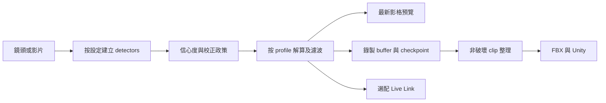

# EmoteCap：獨立 3D 遊戲動作製作的核心設計提案

日期：2026-10-23（America/New_York）。狀態：**owner 已批准進入分段計畫與實作**。本文件承接原 M1–M5，不把待完成的實機／人員／權利門檻移除。

## 使用者已明示的方向

專注獨立遊戲開發者製作 3D 遊戲的動作捕捉，盡量保持簡潔、保留核心技術；提供骨骼／關節配置選擇與獨立上半身擷取，提升精準度與回饋速度。本階段先完成上游權利核對與獨立審查，不安排新實機測試。

## 提案與假設

我的建議是把主要任務定為「用自己的鏡頭／影片產生能放進遊戲的動作 clip」，以 Unity Humanoid／FBX 為第一條完整路徑。即時預覽是製作回饋；Live Link 是選配。這個優先序是提案，不冒稱 owner 已選擇只做離線或即時。

保留現有 React、motion-core、FastAPI、Blender、Unity 及固定依賴。沒有換框架或全面 native rewrite 的必要證據。新的骨架選擇先用有意義的 presets／群組，不做任意整數滑桿或泛用 rig editor；若 owner 要逐骨開關，另明確設計父子依賴與相容規則。

## 成功與非目標

成功是：使用者理解目前追蹤範圍；上半身拍攝不再要求雙腳入鏡；錯誤校正不會被標成功；錄製成本不隨既有 frame 數逐幀複製；輸出與遊戲內 mask/root 行為可追溯且相容既有作品。真正的精準度／延遲提升仍由後續固定資料與實機比較證明，不先寫承諾百分比或 FPS。

不新增多人／多鏡頭／臉部、自訓大型模型、雲端帳號／協作、任意引擎／rig 編輯器、微服務、native shell。現有保存、備份、取消／重試、資料控制與原作品不可變性不能因簡化被犧牲。

## 能力與設定

| 使用者選擇 | 定義 | 第一輪建議 |
|---|---|---|
| 擷取範圍 | 全身或上半身；決定必要觀測點、解算、校正與提示 | full-body／upper-body |
| 手指細節 | 是否建立及執行獨立 hand detector、是否保留手指動畫 | 開／關；關閉不建立 hand model |
| 輸出骨架 | 合法 Humanoid hierarchy／相容格式；不等於 detector 點數 | 沿用完整52或無手指22；不要以刪腿方式製造 upper-body rig |
| 品質／反應 | detector 及濾波政策，必須記錄真實使用配置 | 先保留 Fast／Accurate；量測後再調整，不增加一排不清楚的滑桿 |

主介面可把前兩項呈現為四個 preset：全身、全身＋手指、上半身、上半身＋手指。有效動畫通道數由共同骨骼表計算顯示，不硬編一個無法對應模型的「精度」。偵測點、driven bones、export bones 要各有正確名稱。

## 上半身語意

- 適用 seated／standing 的軀幹、頭、雙臂動作；不把離鏡腿部當作 tracking failure。必要觀測點與提示按 profile 定義。
- 第一版建議固定 pelvis／原地 root，不輸出由看不到的腿推論的跳躍／grounding／planting。髖部可見與不可見要有明確 reference/fallback；肩線／胸部觀測的可觀測限制要提示。
- 頭部缺失時跟隨 torso reference 或有界 hold／relax，不無限保留不相容的舊世界旋轉。inactive lower body 的中性姿態按父子變換求得；不可一概將所有 world deltas 填 identity。
- 保留 v2 的 48 driven／192 values／固定骨序，不直接縮短 frame。capture profile／所需 detectors／effective settings 進入 take provenance；舊專案缺欄時採明確 legacy full-body＋原 fingers/export mapping。
- 新 metadata 的 schema／migration、非法組合拒絕及 profile 切換政策由實作計畫定義並測試。錄製中建議鎖定 profile，避免一個 take 的語意中途改變；改設定需停止／保存再建立新 session，不丟資料。
- Unity 首先提供下身 locomotion＋上身 AvatarMask override 的獨立 sample。定義 mask 是否含 hips、root rotation、vertical motion；不改現有整身 sample 行為，不把 world-delta 當 additive local clip。

## 捕捉核心與速度

1. Camera/import 共用 model selection；手指關閉時不初始化 hands。切換、取消、model 失敗與 consent 撤回有 session generation／owned-resource 收尾。
2. 校正接受明確 sample 或穩定 sample window，不讓 lastPoints 覆蓋 explicit sample。姿勢、visibility、freshness、穩定度要符合 profile；拒絕有可理解原因。
3. confidence 不足的點不污染 filter；定義 missing→hold→relax→reacquire，並保留原始觀測／設定版本以便比較。精準度不能只用更強濾波換取靜態平穩。
4. 錄製由私有 append/chunk buffer 擁有 frame；React 讀節流後 UI snapshot。五秒 checkpoint、stop、backup 都拿 immutable snapshot，保留時間／quaternion／容量驗證及錯誤時可下載原 motion。
5. 先量 capture/model/solver/record/render 階段、input age 與 allocation。若仍需 worker，使用一個 in-flight＋latest-only replacement、有界資源與 timestamp/session identity；先驗證 GPU／OffscreenCanvas，不能排一列過期影格。
6. 保留既有 latest-frame relay 與慢接收端控制；評估 Web、solver、Unity 多層 smoothing 的總 lag，不先刪全部 filter。

## 簡化主流程

主要導航只有擷取、整理、匯出。保存／恢復是基礎能力。Gemini 建議與 Live Link 在進階區按需顯示，但進行中的工作／cleanup error／配對撤銷失敗持續可見；同意與資料生命週期不因收合 UI 消失。

先做 entry/import graph，再刪舊 RecordPanel review 分支與確定不用的 UI；保留 Studio/e2e 共用 playback／TimeField。server compatibility API 不隨 UI 清理直接刪。不要因追求少檔案，把純 solver、儲存、UI 和 subprocess 合併成一個大模組。

## 分段順序與驗證

| 階段 | 結果 | 本階段可證明的事 |
|---|---|---|
| R0 權利結論 | 分開 source／UPM／Windows，記明已知交付完成及 W1/W2 缺口 | 不把非必要 attestation／其他 target 誤當授權義務；不能宣稱未知 notice 已完成 |
| R1 核心整理 | recorder buffer、hands opt-out、單一有效 review/job 路徑 | 長 take snapshot／checkpoint／limits／recovery；沒有額外模型建立；減少重複 UI |
| R2 品質基線 | calibration sample/window、confidence／dropout／reacquisition | 固定 landmarks 的拒絕原因、bias／lag／jitter／overshoot 控制；非真人精度結論 |
| R3 選擇與上半身 | profiles／provenance／root/inactive-bone policy、Unity masked sample | 舊專案可讀、frame v2 parity、profile切換保存、preview→FBX→Unity一致性／mask行為 |
| R4 回饋優化 | stage profiling；必要時 worker＋端到端 freshness | 先量程式階段與 allocation，日後以授權固定影片／M2實機驗證實際改善 |

R1–R4 由獲准設計衍生的 implementation plans 執行，先寫相應行為測試、保留舊證據、獨立審查。會涉及 contract/project schema 的改動必須同步文件、fixtures、Web／server／Blender／Unity consumers；不是單改 UI。

原 Mac3967B2、實際品質／指定筆電效能、第二台乾淨Windows、5位新手4/5於600秒內獨立完成、完整權利與精確發布批准仍是最後產品門檻。本輪依 owner 要求不安排實測，不代表原門檻通過；舊 B2 未來回傳也只證明舊固定來源，不能自動用來資格新版 capture pipeline。

## 交付與待 owner 決定

完整 [獨立審查](../reports/2026-10-23-independent-core-review.zh-TW.md) 及 [權利核對](../../redistribution-assessment-2026-10-23.zh-TW.md) 已具體列出證據。提案保留原架構、以四 presets 開始、上身先固定 pelvis／原地 root、Unity先override mask；這些是可修正的建議，不是冒稱 owner 已逐項批准。

Owner 已指定揮手、比讚、開門為主要動作；目前困擾是捕捉精度低及不能只擷取上半身。2026-10-23 的 fresh builder check 結果為「nothing important left」；owner 隨後明確同意此設計並授權進入分段計畫與實作。優先建立上半身／手指及校正的可靠語意，不把通用即時直播或全引擎整合列為本輪核心。

本輪沿用已選定 Native 執行方式；先以可獨立驗證的 capture foundation increment 落實 recorder buffer 與 detector opt-out，再接續 calibration／confidence、profiles／provenance、Unity mask 及 stage profiling。這是分段次序，不是刪除已批准的後續能力。
